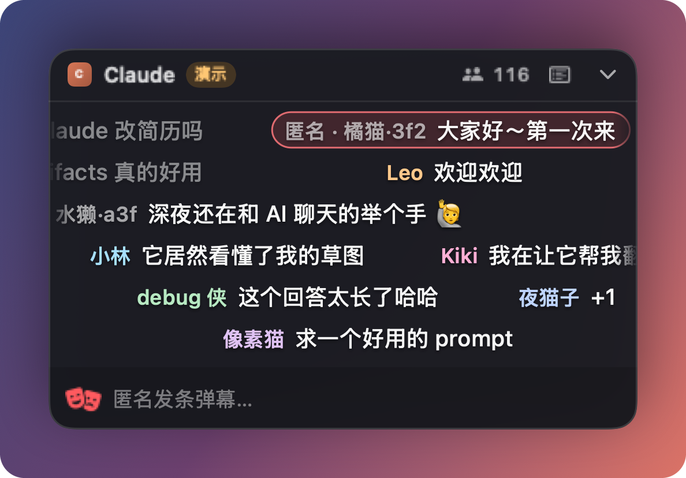
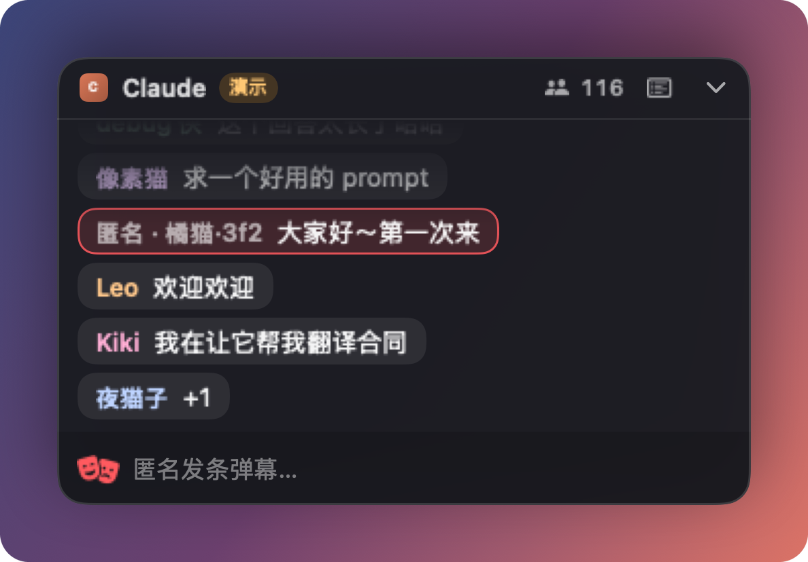

<p align="center">
  
</p>

<h1 align="center">Kuro</h1>

<p align="center">Live danmaku chat on your Mac with everyone using the same app as you.</p>

<p align="center">
  <a href="README.md">中文</a> ·
  <a href="#install">Install</a> ·
  <a href="docs/BACKEND.md">Connect a server</a> ·
  <a href="CONTRIBUTING.md">Contributing</a>
</p>

<p align="center">
  
  
</p>

Kuro lives in the menu bar. While you work in Figma it puts you in the Figma room; switch to Xcode and you are in the Xcode room. Messages drift across a small floating panel ("danmaku", like on a livestream) without getting in your way.

> [!NOTE]
> This repository is the **client**. It ships without a server or database. Until you connect one, Kuro runs in demo mode: the people and messages in each room are simulated on your Mac, and the UI says so. Implement the `ChatService` protocol to plug in your own backend; see [docs/BACKEND.md](docs/BACKEND.md). The UI is in Chinese for now.

## Features

- **One room per app.** Only apps you switch on put you in a room. Editions share a room (VS Code and VS Code Insiders, IntelliJ Ultimate and Community).
- **Online means actually using it.** The app has to be frontmost and you have to be typing or moving the mouse. Switching away keeps your seat for 45 seconds; locking the screen or sleeping leaves right away.
- **Two styles.** Livestream-style messages flying right to left, or a tidy list growing from the bottom.
- **Never steals focus.** Typing in the panel keeps you in the app you were using. Collapse the panel to a capsule with an unread count, tune its background, or pause Kuro for a while.
- **⌃⌥⌘K to chat from anywhere**, Esc to go back to your app.
- **Hover to pause** the danmaku; right-click a message to report, block or copy it.
- **Anonymous or named.** Anonymous messages show a random alias such as "匿名 · 橘猫·3f2" that changes per room and per day.
- **A livestream-style profile**: nickname, username, avatar, bio and accent color.
- **Kept out of screen sharing and recordings**: people in your meeting don't see the panel, while you still do.
- Launch at login, multiple displays, dark mode and input methods are all handled. Scrolling runs on Core Animation, so an idle panel uses no CPU.

<p align="center">
  
</p>

## Privacy

Kuro reads exactly two things: **which app is frontmost** and **how many seconds since your last keyboard or mouse input**. It never reads window contents, keystrokes or the screen, so it needs no Accessibility or Screen Recording permission.

- Only apps on the built-in list that you switch on create rooms. Browsers, messaging, mail, finance and health apps are not on the list, because being seen using them already says too much.
- Nobody can see which apps you use; they only see the people in the same room.
- Apps outside the list are never recorded or sent anywhere.

## Install

### Download

Get the latest `Kuro-*.zip` from [Releases](../../releases), unzip it and drag Kuro.app into Applications.

These builds are not notarized, so macOS blocks the first launch:

- macOS 15 and later: open it once, then click "Open Anyway" at the bottom of System Settings › Privacy & Security.
- macOS 14: right-click Kuro.app in Finder and choose Open.

### Build from source

You need macOS 14+, Xcode 15.3+ and [XcodeGen](https://github.com/yonaskolb/XcodeGen). You do **not** need an Apple Developer account; the project signs to run locally.

```sh
brew install xcodegen
git clone https://github.com/Kyle-zhai/kuro.git
cd kuro
./scripts/bootstrap.sh   # generates Kuro.xcodeproj
open Kuro.xcodeproj      # pick the Kuro scheme, press ⌘R
```

## Connect a server

See [docs/BACKEND.md](docs/BACKEND.md). In short:

1. Write a class that implements [`ChatService`](App/Kuro/Chat/ChatService.swift) and returns `.server(name:)` as its `kind`.
2. Return it from `ChatServiceFactory.make()`.
3. Your server enforces rate limits, anonymous aliases, reports and blocks; the guide lists what it must guarantee.

## Project layout

```
App/Kuro/
  Activity/       frontmost app, idle and lock detection (NSWorkspace + CGEventSource)
  Chat/           the ChatService protocol, models and the local demo backend
  Panel/          the floating panel: scrolling danmaku, stacked list, composer
  Dashboard/      settings window and first-run onboarding
  Settings/       local settings and profile
  System/         global shortcut, launch at login, screenshot rendering
Packages/KuroCore/  AppKit-free core logic with unit tests: room state machine, app catalog,
                    danmaku lanes, list pacing, message rules
docs/               design notes and the backend guide (Chinese)
```

## Contributing

Issues and pull requests are welcome, especially **adding apps to the catalog**. Please read [CONTRIBUTING.md](CONTRIBUTING.md) first.

```sh
swift test --package-path Packages/KuroCore
```

## License

[MIT](LICENSE)
