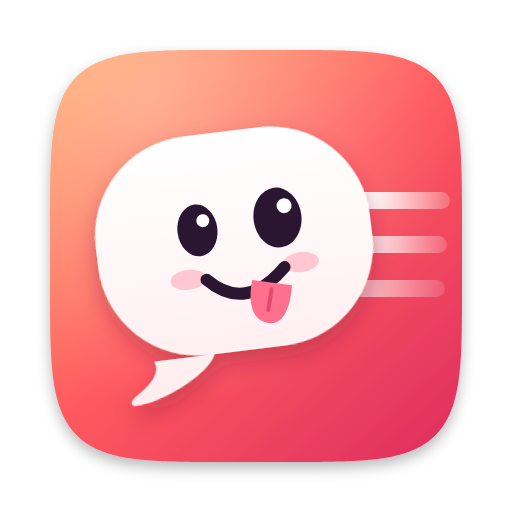
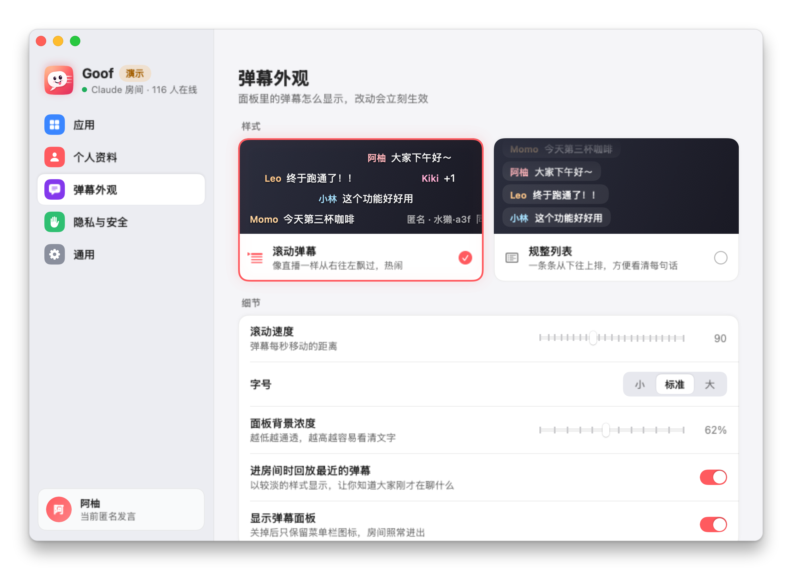
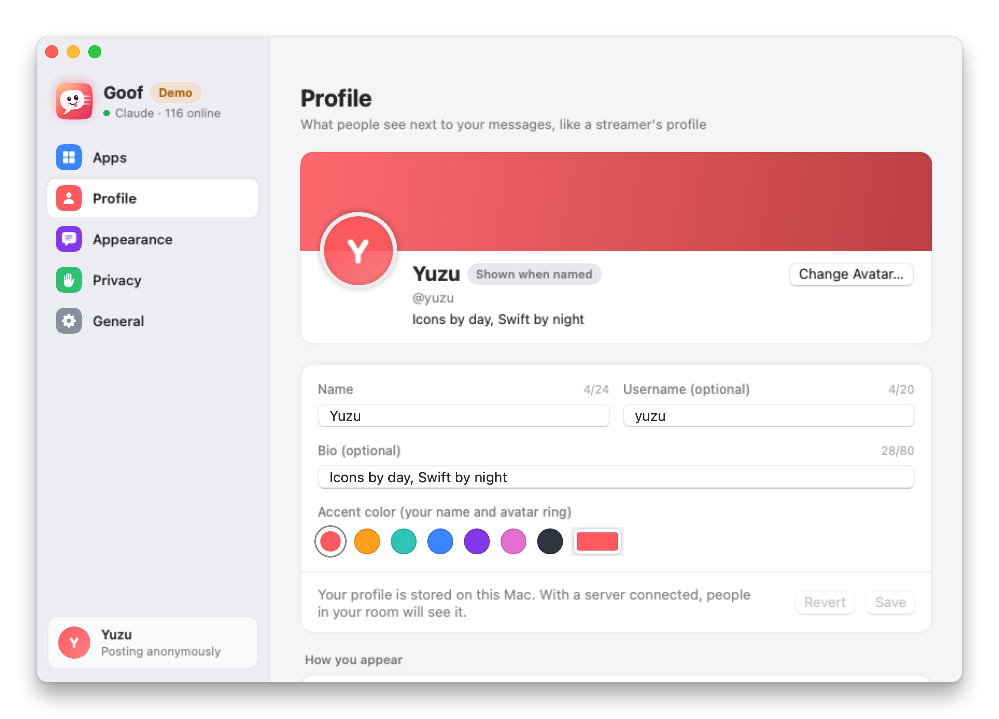

<p align="center">
  
</p>

<h1 align="center">Goof</h1>

<p align="center">
  <b>你正在用的这个 App，此刻也有别人在用。</b><br>
  Goof 把你们放进同一个房间，在屏幕角落一起发弹幕。
</p>

<p align="center">
  <a href="#怎么玩">怎么玩</a> ·
  <a href="#里面有什么">里面有什么</a> ·
  <a href="#下载">下载</a> ·
  <a href="README.en.md">English</a>
</p>

<p align="center">
  
  
</p>

深夜还开着 Figma 的，不止你一个；对着 Xcode 等编译的，也不止你一个。只是平时谁也看不见谁。

Goof 住在 Mac 的菜单栏里。你切到哪个 App，它就带你进那个 App 的房间：开着 Figma 的人在 Figma 房间，开着 Claude 的人在 Claude 房间。房间里的弹幕只在一块小小的悬浮面板里飘过，不挡你干活。

## 怎么玩

1. **挑几个 App。** 第一次打开时，勾选你愿意「进房间」的 App，比如 Claude、Figma、VS Code。没勾选的 App，Goof 当它不存在。
2. **切过去，就进房间。** 在勾选过的 App 里待上 3 秒，悬浮面板就会出现，标题栏上写着这是哪个房间、有多少人在线。刚进门时，最近的弹幕会先淡淡地过一遍，让你知道大家在聊什么。
3. **说句话。** 在面板里打字，回车，你的弹幕就会飘过房间里每个人的屏幕。在任何 App 里按 <kbd>⌃</kbd> <kbd>⌥</kbd> <kbd>⌘</kbd> <kbd>K</kbd> 都能直接开打，按 <kbd>Esc</kbd> 回到手头的事。
4. **切走，就离开。** 切出去查个东西，45 秒内回来还在房间里。锁屏或合上盖子会立刻离开；人走开了（默认 2 分钟没碰键盘鼠标），也就不算在线了。

### 小技巧

| 想做的事 | 怎么做 |
| --- | --- |
| 看清一条弹幕 | 把鼠标停在上面，它会停下来 |
| 举报、屏蔽、复制 | 在弹幕上右键 |
| 切换匿名和实名 | 点输入框左边的面具按钮 |
| 挪个位置、改个大小 | 拖标题栏或弹幕区域；拖右下角 |
| 收起面板 | 点标题栏右边的 ⌄，面板缩成一个显示未读数的小胶囊 |
| 安静一会儿 | 菜单栏 › 暂停 Goof：30 分钟、1 小时、今天剩下的时间，或者直到手动恢复 |
| 面板找不到了 | Dashboard › 弹幕外观 › 重置位置 |

## 里面有什么

### 两种弹幕样式

**滚动弹幕**像直播间一样从右往左飘，几条轨道互不遮挡。**规整列表**让弹幕一条条从下往上排，适合想把每句话都看清楚的时候。两种样式在菜单栏里随时切换，滚动速度、字号和面板背景的浓淡也都能调。

<p align="center">
  <picture>
    <source media="(prefers-color-scheme: dark)" srcset="docs/images/dashboard-appearance-dark.png">
    
  </picture>
</p>

### 像直播间账号一样的你

昵称、用户名、头像、一句话简介和主题色（昵称和头像框的颜色），别人在弹幕里看到的就是这些。

想低调的时候就用匿名，这也是默认设置。匿名时你会得到一个像「匿名 · 橘猫·3f2」这样的随机昵称，同一天、同一个房间里保持不变，第二天换一个新的。

<p align="center">
  <picture>
    <source media="(prefers-color-scheme: dark)" srcset="docs/images/dashboard-profile-dark.png">
    
  </picture>
</p>

### 36 个 App 房间

分成 AI、编程、设计、办公、创作五类：Claude、ChatGPT、VS Code、Cursor、Xcode、终端、Figma、Photoshop、Notion、Obsidian、Final Cut Pro、Blender……一个 App 一个房间，VS Code 正式版和 Insiders、IntelliJ 旗舰版和社区版算同一个房间。所有 App 默认关闭，在 Dashboard 里一个个打开。想加新的 App，欢迎[提一个申请](../../issues/new?template=app_request.yml)。

<p align="center">
  <picture>
    <source media="(prefers-color-scheme: dark)" srcset="docs/images/dashboard-apps-dark.png">
    
  </picture>
</p>

### 直播弹幕的节奏

- 弹幕是实时的。进房间时先回放最近 10 分钟里的弹幕（最多 50 条），颜色淡一些，之后就只有实时的。
- 弹幕只留 24 小时左右：这是弹幕，不是聊天记录。
- 每条最多 80 个字，3 秒才能发一条，30 秒内不能重复同一句话，谁也刷不了屏。

### 一块不打扰你的小面板


- 不抢焦点：在面板里打字时，你还停留在原来的 App 里。
- 可以收起成一个小胶囊，有新弹幕时显示未读数。
- 屏幕共享和录屏时自动隐藏，开会时别人看不到。
- 菜单栏图标上能看到当前房间的在线人数。
- 多显示器、深色模式、中文输入法都照顾到了。

## 隐私

Goof 只知道两件事：现在最前面的是哪个 App，以及你多久没碰键盘鼠标了。它不读窗口内容、不记录按键、不截屏，所以不需要任何系统权限。

- 别人看不到你在用哪些 App，只会在同一个房间里遇见你。
- 浏览器、聊天、邮件、银行、健康这类 App 不在可选范围里：被人知道你在用它们，本身就是一种泄露。

## 下载

到 [Releases](../../releases) 下载最新的 `Goof-*.zip`，解压后把 Goof.app 拖进「应用程序」文件夹。需要 macOS 14 或更新的系统。

这个版本没有经过 Apple 公证，第一次打开会被系统拦下：

- macOS 15 及以上：先双击打开一次，再到「系统设置 › 隐私与安全性」底部点「仍要打开」。
- macOS 14：在 Finder 里右键 Goof.app，选「打开」。

也可以自己从源码构建，需要 Xcode 15.3 以上，不需要 Apple 开发者账号：

```sh
brew install xcodegen
git clone https://github.com/Kyle-zhai/goof.git && cd goof
./scripts/bootstrap.sh && open Goof.xcodeproj   # 选 Goof，按 ⌘R
```

> [!NOTE]
> 这个仓库只有 App 本身，不带服务器。没接服务器时，Goof 以演示模式运行：房间里的人和弹幕都在你的 Mac 上模拟，界面上会标「演示」。想和真实的人一起玩，按 [docs/BACKEND.md](docs/BACKEND.md) 接上你自己的服务器就行。

## 参与

欢迎提 issue 和 PR，最欢迎的是往可选列表里加 App，做法见 [CONTRIBUTING.md](CONTRIBUTING.md)。

## 许可证

[MIT](LICENSE)
