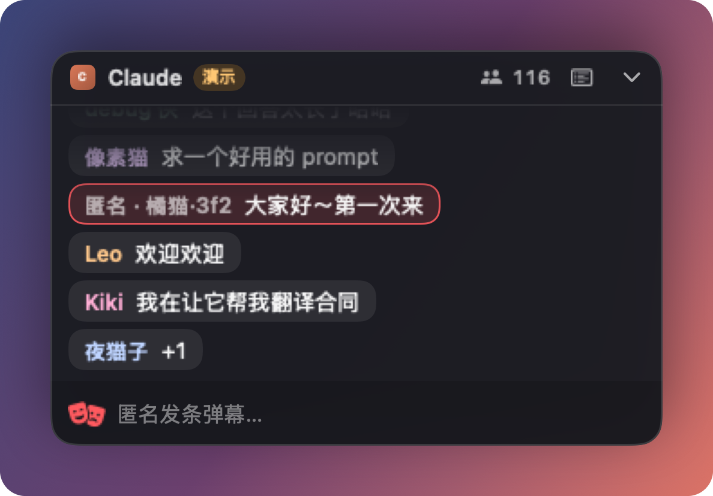
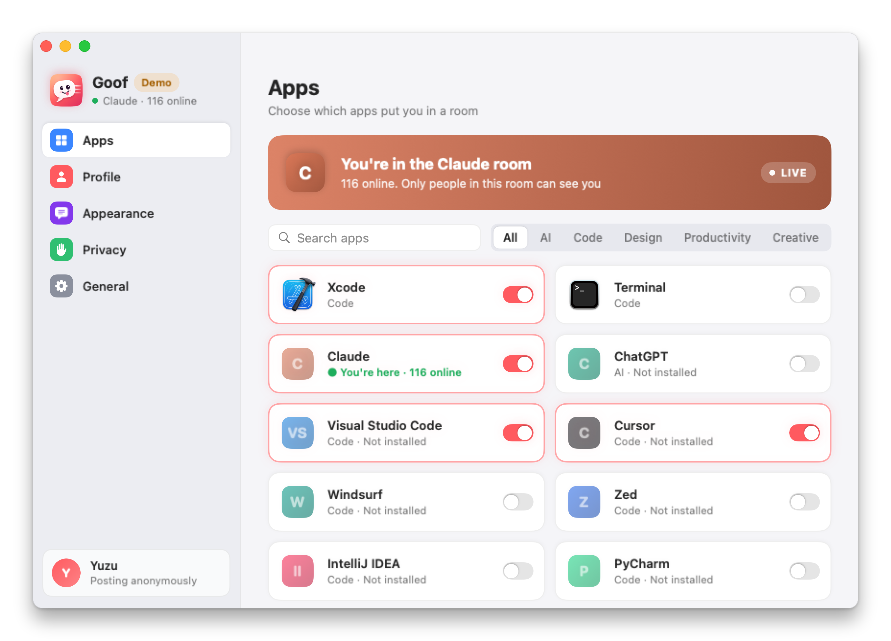
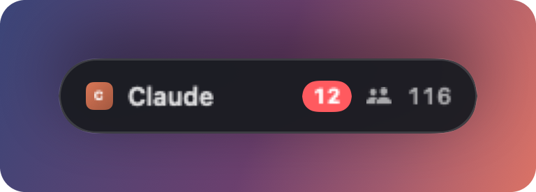

<p align="center">
  
</p>

<h1 align="center">Goof</h1>

<p align="center">
  <b>Someone else is using the same app as you, right now.</b><br>
  Goof puts you in the same room and lets you chat in danmaku at the corner of your screen.
</p>

<p align="center">
  <a href="#how-to-play">How to play</a> ·
  <a href="#whats-inside">What's inside</a> ·
  <a href="#download">Download</a>
</p>

<p align="center">
  
  
</p>

You are not the only one with Figma open at midnight, or the only one staring at Xcode while it builds. You just can't see each other.

Goof lives in your Mac's menu bar. Whatever app you switch to, it takes you to that app's room: people in Figma are in the Figma room, people in Claude are in the Claude room. Messages drift across a small floating panel ("danmaku", like the comments that fly across a livestream) without getting in your way.

## How to play

1. **Pick a few apps.** The first time you open Goof, turn on the apps you're happy to be seen in, like Claude, Figma or VS Code. Goof ignores every app you leave off.
2. **Switch to one and you're in.** Stay in one of those apps for 3 seconds and the floating panel appears, showing which room you're in and how many people are online. As you walk in, the latest messages replay faintly, so you can catch up on what people are talking about.
3. **Say something.** Type in the panel and press Return: your message flies across the screen of everyone in the room. Press <kbd>⌃</kbd> <kbd>⌥</kbd> <kbd>⌘</kbd> <kbd>K</kbd> in any app to start typing right away, and <kbd>Esc</kbd> to get back to what you were doing.
4. **Switch away and you leave.** Pop out to look something up and you keep your seat for 45 seconds. Locking the screen or closing the lid leaves right away, and if you step away (no keyboard or mouse for 2 minutes by default), you stop counting as online.

### Tips

| To | Do this |
| --- | --- |
| Read a message before it flies off | Hover over it and it stops |
| Report, block or copy | Right-click the message |
| Switch between anonymous and named | Click the mask button left of the input field |
| Move or resize the panel | Drag the title bar or the messages; drag the bottom-right corner |
| Tuck the panel away | Click ⌄ in the title bar: the panel shrinks into a small capsule with an unread count |
| Get some quiet | Menu bar › Pause Goof: 30 minutes, 1 hour, the rest of today, or until you resume |
| Find a lost panel | Dashboard › Appearance › Reset Position |

## What's inside

### Two message styles

**Scrolling** works like a livestream: messages drift from right to left in lanes that never overlap. **Stacked** lines messages up from the bottom, for when you want to read every one. Switch between them from the menu bar at any time, and tune the speed, the text size and how solid the panel's background is.

<p align="center">
  <picture>
    <source media="(prefers-color-scheme: dark)" srcset="docs/images/dashboard-appearance-dark.png">
    
  </picture>
</p>

### A profile like a streamer's

A name, a username, an avatar, a one-line bio and an accent color (used for your name and avatar ring). That is what people see next to your messages.

When you'd rather stay low-key, post anonymously, which is the default. You then get a random name like “Anon Tabby·3f2” that stays the same within a room for the day and changes the next day.

<p align="center">
  <picture>
    <source media="(prefers-color-scheme: dark)" srcset="docs/images/dashboard-profile-dark.png">
    
  </picture>
</p>

### 36 app rooms

In five groups, AI, code, design, productivity and creative: Claude, ChatGPT, VS Code, Cursor, Xcode, Terminal, Figma, Photoshop, Notion, Obsidian, Final Cut Pro, Blender and more. Each app is one room, and editions share it (VS Code and VS Code Insiders, IntelliJ Ultimate and Community). Every app starts switched off; turn them on one by one in the Dashboard. Missing an app? [Request it](../../issues/new?template=app_request.yml).

<p align="center">
  <picture>
    <source media="(prefers-color-scheme: dark)" srcset="docs/images/dashboard-apps-dark.png">
    
  </picture>
</p>

### The rhythm of livestream danmaku

- Messages are live. When you join a room, the last 10 minutes (up to 50 messages) replay in a fainter style; after that you only see what's new.
- Messages only stay around for about 24 hours: this is danmaku, not a chat log.
- Up to 80 characters per message, one every 3 seconds, and no repeating yourself within 30 seconds, so nobody can flood the room.

### A panel that stays out of your way



- It never steals focus: while you type in the panel, you stay in your app.
- Tuck it into a small capsule that shows how many new messages arrived.
- It hides itself while you share or record your screen, so nobody in the meeting sees it.
- The menu bar icon shows how many people are in your room.
- Works with multiple displays, dark mode and input methods for languages like Chinese and Japanese.

## Privacy

Goof knows two things: which app is in front, and how long ago you last touched the keyboard or mouse. It doesn't read windows, log keystrokes or capture the screen, so it needs no system permissions.

- Nobody can see which apps you use. They can only meet you in the same room.
- Browsers, messaging, email, banking and health apps are not on the list: being seen using one is a leak in itself.

## Download

Get the latest `Goof-*.zip` from [Releases](../../releases), unzip it and drag Goof.app into Applications. Goof needs macOS 14 or later.

The build is not notarized by Apple, so macOS blocks it the first time:

- macOS 15 and later: double-click it once, then open System Settings › Privacy & Security and click “Open Anyway” at the bottom.
- macOS 14: right-click Goof.app in Finder and choose Open.

You can also build it yourself with Xcode 15.3 or later. No Apple Developer account needed:

```sh
brew install xcodegen
git clone https://github.com/Kyle-zhai/goof.git && cd goof
./scripts/bootstrap.sh && open Goof.xcodeproj   # pick Goof, press ⌘R
```

> [!NOTE]
> This repository is the app only, without a server. Until you connect one, Goof runs in demo mode: the people and messages in each room are simulated on your Mac, and the UI marks it Demo. To play with real people, connect your own server as described in [docs/BACKEND.md](docs/BACKEND.md).

## Contributing

Issues and pull requests are welcome, most of all new apps for the list. See [CONTRIBUTING.md](CONTRIBUTING.md).

## License

[MIT](LICENSE)
