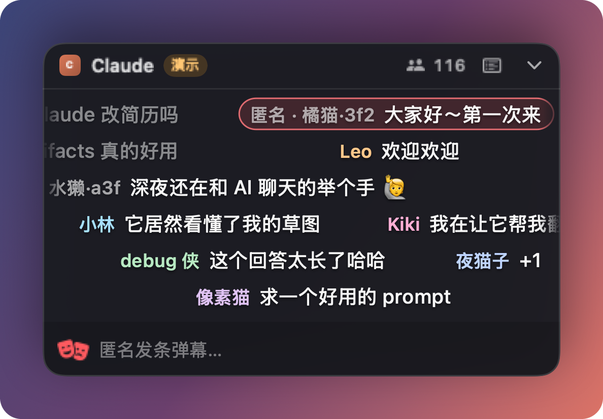

<p align="center">
  
</p>

<h1 align="center">Kuro</h1>

<p align="center">和正在用同一个应用的人，一起在 Mac 上发弹幕。</p>

<p align="center">
  <a href="README.en.md">English</a> ·
  <a href="#安装">安装</a> ·
  <a href="docs/BACKEND.md">接入服务器</a> ·
  <a href="CONTRIBUTING.md">参与贡献</a>
</p>

<p align="center">
  
  
</p>

Kuro 住在菜单栏里。你在用 Figma，它就把你放进「Figma 房间」；切到 Xcode，就换到「Xcode 房间」。房间里的弹幕只在一个小小的悬浮面板里飘过，不挡你干活。

> [!NOTE]
> 这个仓库是**客户端**，不包含服务器和数据库。没有接服务器时，Kuro 以演示模式运行：房间里的人和消息在本机模拟，界面上会标「演示」。实现一个 `ChatService` 协议就能接上你自己的后端，见 [docs/BACKEND.md](docs/BACKEND.md)。

## 特性

- **按应用分房间**：只有你亲自开启的应用会让你进房间。VS Code 正式版和 Insiders、IntelliJ 旗舰版和社区版算同一个房间。
- **真的在用才算在线**：应用在前台、并且你在操作键盘鼠标才算。切走有 45 秒宽限期，锁屏、睡眠立刻离开。
- **两种弹幕样式**：像直播一样从右往左飘的「滚动弹幕」，或者一条条从下往上排的「规整列表」，随时切换。
- **不抢焦点**：在面板里打字时，你仍然停留在原来的应用里。面板可以收起成小胶囊（会显示未读数）、调背景浓度、暂停一段时间。
- **⌃⌥⌘K 快速发弹幕**：在任何应用里把光标直接放进输入框，按 Esc 回到原来的应用。
- **鼠标停在弹幕上就暂停**，右键可以举报、屏蔽或复制。
- **匿名或实名**：匿名时只显示「匿名 · 橘猫·3f2」这样当天、当房间有效的随机昵称。
- **像直播账号一样的资料**：昵称、用户名、头像、简介和主题色。
- **共享屏幕时自动隐藏面板**，开会不尴尬。
- 开机启动、多显示器、深色模式和中文输入法都照顾到了。滚动弹幕交给 Core Animation，空闲时不占 CPU。

<p align="center">
  
</p>

## 隐私

Kuro 只读取两样东西：**当前前台是哪个应用**，以及**距离上次键盘鼠标操作过了几秒**。它不读窗口内容、按键内容或屏幕，所以不需要辅助功能、屏幕录制等任何系统权限。

- 只有白名单里、并且你开启了的应用会产生房间。浏览器、聊天、邮件、金融、健康类应用不在白名单里，因为「被看到在用它」本身就会泄露信息。
- 别人永远看不到你在用哪些应用，只能看到同一个房间里的人。
- 不在白名单里的应用，Kuro 什么都不记录、不上传。

## 安装

### 下载

到 [Releases](../../releases) 下载最新的 `Kuro-*.zip`，解压后把 Kuro.app 拖进「应用程序」文件夹。

这个构建没有经过 Apple 公证，第一次打开会被系统拦下：

- macOS 15 及以上：双击打开一次，然后到「系统设置 › 隐私与安全性」底部点「仍要打开」。
- macOS 14：在 Finder 里右键 Kuro.app，选「打开」。

### 从源码构建

需要 macOS 14 以上、Xcode 15.3 以上和 [XcodeGen](https://github.com/yonaskolb/XcodeGen)。**不需要** Apple 开发者账号，工程默认用本机签名。

```sh
brew install xcodegen
git clone https://github.com/Kyle-zhai/kuro.git
cd kuro
./scripts/bootstrap.sh   # 生成 Kuro.xcodeproj
open Kuro.xcodeproj      # 选 Kuro，按 ⌘R
```

## 使用

1. 第一次打开会有三步引导：了解 Kuro、选择应用、设置昵称和弹幕样式。
2. 切到一个已经开启的应用，3 秒后进入它的房间，悬浮面板出现。
3. 在面板里打字，回车发送。输入框左边的面具按钮切换匿名和实名。
4. 菜单栏图标里可以切换样式、暂停 Kuro、打开 Dashboard。

| 想做的事 | 怎么做 |
| --- | --- |
| 快速发弹幕 | ⌃⌥⌘K，发完按 Esc 回到原来的应用 |
| 移动面板 | 拖动标题栏或弹幕区域 |
| 调整大小 | 拖动右下角 |
| 收起和展开 | 标题栏右边的 ⌄；点小胶囊展开 |
| 举报、屏蔽、复制 | 在弹幕上右键 |
| 暂停 | 菜单栏 › 暂停 Kuro：30 分钟、1 小时、今天剩下的时间，或直到手动恢复 |
| 面板找不到了 | Dashboard › 弹幕外观 › 重置位置 |

## 接入服务器

详细说明见 [docs/BACKEND.md](docs/BACKEND.md)。简单来说：

1. 写一个类实现 [`ChatService`](App/Kuro/Chat/ChatService.swift)，`kind` 返回 `.server(name:)`。
2. 在 `ChatServiceFactory.make()` 里返回它。
3. 服务器负责限流、匿名昵称、举报和屏蔽，文档里列出了它必须保证的事情。

## 项目结构

```
App/Kuro/
  Activity/       前台应用、空闲和锁屏检测（NSWorkspace + CGEventSource）
  Chat/           ChatService 协议、消息模型和本地演示后端
  Panel/          悬浮面板：滚动弹幕、规整列表、输入框
  Dashboard/      设置窗口和首次引导
  Settings/       本机设置和个人资料
  System/         全局快捷键、开机启动、截图渲染
Packages/KuroCore/  不依赖 AppKit 的核心逻辑和单元测试：房间状态机、应用白名单、弹幕轨道、发送节奏、消息规则
docs/               设计文档和后端接入说明
```

设计细节见 [docs/ARCHITECTURE.md](docs/ARCHITECTURE.md)。

## 参与贡献

欢迎提 issue 和 PR，尤其是**往白名单里添加应用**。动手前请看 [CONTRIBUTING.md](CONTRIBUTING.md)。

```sh
swift test --package-path Packages/KuroCore
```

## 许可证

[MIT](LICENSE)
